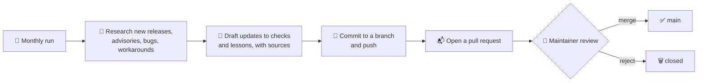

<div align="center">

# 🛡️ pfsense-audit-skill

### A read-only pfSense audit that knows the traps checklists miss, and keeps itself current.

[](LICENSE)
[](#-version-support)
[](docs/VALIDATING-26.10.md)
[](#-safety-first)
[](#-it-keeps-itself-current)
[](#-quick-start)

**Point it at a pfSense box. Get back a prioritized report of what is risky, what is broken, and exactly how to fix it.**

[Quick start](#-quick-start) · [What it checks](#-what-it-checks) · [Lessons](#-lessons-from-the-field) · [Self-updating](#-it-keeps-itself-current) · [Safety](#-safety-first) · [Roadmap](#-roadmap)

</div>

---

> [!NOTE]
> **Status: early development.** This first release is being built from real small-business deployments and a deep research pass on current pfSense guidance. Every check listed under *What it checks* is implemented. Items marked 🔬 run today but have not yet been confirmed on a live box (`verified_on = ["unverified"]` in `checks.toml`, or a manual step); unverified checks report WARN at most. 🧪 marks work that is planned and not built yet. Watch or star the repo to follow along.

## ✨ Why this exists

Most pfSense hardening guides are a list of settings. Real firewalls fail in quieter ways:

- 💾 **Backups that never leave the box.** AutoConfigBackup shows *enabled*, yet nothing has uploaded for days.
- 🔕 **Monitoring that watches the wrong thing.** The gateway monitor pings the ISP modem, so a real outage never alerts anyone.
- 🧩 **Settings that silently do nothing.** A copied pfBlockerNG config looks right, while DNSBL quietly stays disabled.
- 🕳️ **A rogue DHCP server hiding behind a managed switch** for a year, until the old firewall goes offline and it starts winning.
- 🔐 **Filtering that only works over TLS**, because the ISP intercepts plain DNS.

This skill audits for the textbook items **and** for the traps we have actually been bitten by, then explains each finding in plain language with the fix.

## 🚀 Quick start

**Plain Python, no installs.** Python 3.11 or newer, standard library only.

```bash
git clone https://github.com/tatsuikeda/pfsense-audit-skill
cd pfsense-audit-skill
python3 pfaudit.py 192.0.2.1                         # your firewall's address; SSH key auth as admin
python3 pfaudit.py 192.0.2.1 --external --feeds      # add outside-in probes and feed health
```

| Flag | What it adds |
|---|---|
| `--external` | Probes your WAN from this machine (run it from outside the network) |
| `--feeds` | Tests every pfBlockerNG feed URL for dead or empty lists |
| `--updates` | Asks the firewall to check for pfSense updates |
| `--dhcp-scan` | Listens 45 seconds on the LAN for rogue DHCP servers |
| `--unifi URL` | Reads a UniFi OS console (read-only GETs) for the UniFi checks, e.g. `--unifi https://unifi.example.com` |
| `--unifi-key-env NAME` | Environment variable holding the UniFi API key (default `UNIFI_API_KEY`). The key itself is never a flag |
| `--unifi-site NAME` | UniFi site short name, default `default` |
| `--unifi-ca FILE` | CA bundle or the console's own certificate, to verify TLS |
| `--unifi-insecure` | Skips TLS verification. Explicit opt-in only, and the report carries a warning |
| `--unifi-open-ssid NAME` | An SSID that is open on purpose (repeatable), so UNIFI-003 reports it as info |
| `--json` | Machine-readable output |

### 📡 UniFi checks (`--unifi`)

```bash
read -rs UNIFI_API_KEY && export UNIFI_API_KEY   # paste the key, nothing is echoed
python3 pfaudit.py 192.0.2.1 --unifi https://unifi.example.com --unifi-ca console.pem
```

- **Key:** create it in the console under Network > Settings > Control Plane > Integrations (older builds: Integrations in the sidebar). It is shown once. A key has **all the rights of the admin who created it** and the API offers no read-only scope, so create it from a dedicated local admin with the least role that can make keys, and delete it after the audit. Never put the key on the command line or in a file inside this repo.
- **What it reads:** only `GET` requests, sent with an `X-API-KEY` header, no proxies, redirects refused (so the key is never sent to another host).
  - **Integration API** (documented, `/proxy/network/integration/v1/...`): `info`, `sites`, `devices`, and on Network 10.0 or newer `networks` and `wifi/broadcasts` (one detail call each). Feeds UNIFI-001, UNIFI-003 and parts of UNIFI-005 and UNIFI-007.
  - **Legacy API** (undocumented, `/proxy/network/api/s/<site>/...`): `get/setting`, `rest/networkconf`, `rest/wlanconf`, `stat/device`. The only source for DHCP Snooping, the guest flag, guest restricted subnets, device inform host and auto-upgrade (UNIFI-002, 004, 005, 007).
- **Legacy API authentication is unconfirmed.** It is called with the same API key. Some client libraries do this on UniFi OS; other guides say the legacy API only accepts a session login. pfaudit does not log in, because that needs a `POST`; if the key is refused, the legacy-only checks are skipped with the HTTP status. A self-hosted Network application that is not on UniFi OS (port 8443) is not supported.
- **Secrets are dropped on arrival.** Both APIs return Wi-Fi passphrases, SSH passwords and VPN keys in normal reads. Every field starting with `x_`, and fields such as `passphrase` and `presharedKeys`, are removed as soon as a response is decoded; only `x_ssh_enabled` and `x_ssh_auth_password_enabled` are kept, as booleans. Nothing from the controller is written to disk or printed except the findings.
- **TLS:** verified by default. UniFi consoles ship a self-signed certificate, so pass it (or your CA) with `--unifi-ca`, and use the hostname it was issued for. Python 3.13 and newer apply strict X.509 checks that some self-signed certificates fail; pfaudit reports that rather than relaxing them. `--unifi-insecure` is the last resort.
- **Status:** written against Ubiquiti's Network 11.0.97 OpenAPI spec and field names from a Network 11.0.97 database. Not yet run against a live console; checks marked `unverified` in `checks.toml` report WARN at most.

You get a report grouped 🔴 fix now, 🟠 fix soon, 🔵 FYI, 🟢 good, each with *why it matters* and *how to fix it*. The exit code is non-zero when anything fails, so it slots into scheduled checks.

**How it stays read-only:** only standard FreeBSD and pfSense read commands run on the firewall (`cat`, `pfctl -si`, `sockstat`, `sysctl`, `zpool`, `drill`). Nothing is uploaded or executed there. `config.xml` is parsed in memory on your machine, never written to disk, and secret values never appear in the report.

### 🤖 As a Claude Code skill

```bash
git clone https://github.com/tatsuikeda/pfsense-audit-skill ~/.claude/skills/pfsense-audit
```

Then just ask Claude Code: *"audit the pfSense firewall at 192.0.2.1"* (with your firewall's address). The skill asks how you log in (SSH key preferred, never a pasted password), runs the same read-only audit, and walks you through the 🔴 and 🟠 findings in plain language. It never changes your firewall unless you explicitly ask for a specific fix.

## 🔍 What it checks

**56 checks** across 10 areas, cataloged in [`checks.toml`](checks.toml). Each one lists the versions it was confirmed on, so you know which results to trust.

| Area | Highlights |
|---|---|
| 🔐 **Access & exposure** | GUI and SSH exposure, key-only SSH, admin account hygiene, what is reachable from the WAN (tested from outside), what VPN users can reach |
| 🌐 **DNS** | Resolver vs forwarding, DNS over TLS, DNSSEC interplay with filtering resolvers, client DNS bypass (53, 853, DoH), ISP DNS interception |
| 🚫 **pfBlockerNG** | Dead and stale feeds, wildcard (TLD) coverage, CNAME validation, Kill States, Python Control, false positives in real traffic |
| 🔑 **VPN** | Ciphers, TLS-crypt, CRL presence, cert lifetimes and auto-renew, OpenVPN DCO state, MFA for VPN logins 🔬 |
| ⚡ **Performance** | AES-NI and hardware crypto, NIC offloading (TSO, LRO), CPU frequency scaling (SpeedStep, Speed Shift) 🔬 |
| 🌡️ **Hardware health** | Thermal sensors, disk SMART, ZFS pool health, boot environments, auto power-on after outage (manual check) 🔬 |
| 🔋 **Power** | NUT status, UPS alerts, shutdown thresholds |
| 📣 **Monitoring & alerts** | Gateway monitor target, SMTP alerts, certificate expiry alerts, remote syslog |
| 💾 **Recovery** | AutoConfigBackup actually uploading, local backups, System Patches |
| 📡 **UniFi behind pfSense** | DHCP Guarding and Snooping, guest SSIDs and restricted subnets without a UniFi gateway, controller inform host, auto-upgrade (read-only via `--unifi`; DHCP Guarding, guest SSID and inform host checks not yet run on a live console 🔬) |

## 🧠 Lessons from the field

Every check traces back to something real. A taste of [`LESSONS.md`](LESSONS.md):

| Trap | What you see | What is actually happening |
|---|---|---|
| ACB upload job missing | "Enabled", no errors | Backups stage locally and never upload |
| Copied pfBlockerNG settings | DNSBL looks configured | A renamed VIP setting leaves DNSBL off, with one log line |
| Unbound custom options | Fine for months | Enabling forwarding moves them after a `forward-zone`, and Unbound will not start |
| DNSSEC + filtering resolver | Blocked sites show a generic error | Validation rejects the resolver's block answer |
| Gateway monitor default | Always green | It pings the modem, not the internet |
| Plain DNS to a filter | Filter "not working" | The ISP gateway answers port 53 itself |

## 🔄 It keeps itself current

pfSense changes fast, and 26.10 merges CE and Plus. Static checklists rot. This repo maintains itself:



- **Sources it watches:** Netgate release notes and security advisories, the pfSense bug tracker, Netgate forum, r/PFSENSE, and pfBlockerNG feed health.
- **Every change cites its sources** in the pull request, so you can check the evidence.
- **A human merges.** The research reads the open internet, and anyone can post there. Changes land as pull requests so nothing reaches `main`, or your firewall, without review.

**How it runs:** the maintainer's own Claude Code session does the monthly research by following [`docs/SELF-UPDATE.md`](docs/SELF-UPDATE.md), commits to an `auto-update/YYYY-MM` branch and opens a draft pull request. There is no API key in GitHub Actions.

| Step | Where | Guard rail |
|---|---|---|
| 🔎 Research and edit | Maintainer's Claude Code session | Only `checks.toml`, `LESSONS.md`, `CHANGELOG.md` and `research/` may change; web content is treated as untrusted data |
| 🚧 Gate | Locally, then again in the **Update gate** workflow | Uses the gate from `main`; fails on any other path, deleted history, edits to human-verified checks, a new check not marked `unverified`, dashes, real IPs or MACs, credentials or @mentions |
| ✅ Validate | **CI** workflow | `checks.toml` parses, every check is implemented or marked `planned`, unit tests pass on Python 3.11 and 3.13 |
| 📬 Propose | Draft pull request | The research note is shown inside a code block, so nothing in it can render as a mention or link |

**Reviewing it:** read `research/YYYY-MM.md` first, open the sources, then merge or close.

## 🛡️ Safety first

- **Read-only by default.** The audit inspects and reports. It does not change your firewall.
- **Fixes are opt-in** 🧪 and labelled with what they restart and whether traffic is interrupted.
- **Secrets stay out of reports.** Passwords, keys and tokens are masked.
- **No data leaves your machine** except the SSH session to your own firewall (and, with `--unifi`, read-only HTTPS requests to your own UniFi console).

## 📦 Version support

| Version | Status |
|---|---|
| pfSense CE 2.9.0 | 🛠️ Developed and tested here |
| pfSense 26.10 (CE and Plus merge) | ⏳ Pending validation. Known gaps, including a false DCO WARN and a version check that only recognizes 2.9, are listed in [docs/VALIDATING-26.10.md](docs/VALIDATING-26.10.md). The badge changes to *tested* only after that checklist passes |
| pfSense Plus 26.03 / 26.07 | 🧪 Planned, not validated (the same known gaps apply) |
| pfSense CE 2.8.x and older | ➖ Best effort, not a target |

## 🗺️ Roadmap

- [x] `LESSONS.md`: 25 traps, written up with symptoms and fixes
- [x] `checks.toml`: 56 checks with versions, risk, verify and fix steps (50 with a confirmed version, 5 unverified, 1 manual)
- [x] Read-only UniFi controller checks (`--unifi`)
- [ ] UniFi checks run against a live console (lab test of API key access to the legacy API)
- [x] Read-only audit script, `pfaudit.py` (Markdown and JSON output)
- [x] Claude Code skill (`SKILL.md`)
- [ ] Monthly self-update workflow (branch + pull request)
- [ ] Validation on pfSense 26.10
- [ ] Opt-in fixes

## 🤝 Contributing

Found a trap we missed? Open an issue with what you saw, what was really happening, and your pfSense version. Real-world war stories make the best checks.

## 📄 License

[MIT](LICENSE) © 2026 Tatsu Ikeda

<div align="center">
<sub>Not affiliated with Netgate. pfSense is a trademark of Rubicon Communications, LLC (Netgate).</sub>
</div>
