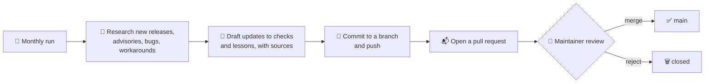

<div align="center">

# 🛡️ pfsense-audit-skill

### A read-only pfSense audit that knows the traps checklists miss, and keeps itself current.

[](LICENSE)
[](#-version-support)
[](#-version-support)
[](#-safety-first)
[](#-it-keeps-itself-current)
[](#-quick-start)

**Point it at a pfSense box. Get back a prioritized report of what is risky, what is broken, and exactly how to fix it.**

[Quick start](#-quick-start) · [What it checks](#-what-it-checks) · [Lessons](#-lessons-from-the-field) · [Self-updating](#-it-keeps-itself-current) · [Safety](#-safety-first) · [Roadmap](#-roadmap)

</div>

---

> [!NOTE]
> **Status: early development.** This first release is being built from real small-business deployments and a deep research pass on current pfSense guidance. Checks marked 🧪 are planned and not yet implemented. Watch or star the repo to follow along.

## ✨ Why this exists

Most pfSense hardening guides are a list of settings. Real firewalls fail in quieter ways:

- 💾 **Backups that never leave the box.** AutoConfigBackup shows *enabled*, yet nothing has uploaded for days.
- 🔕 **Monitoring that watches the wrong thing.** The gateway monitor pings the ISP modem, so a real outage never alerts anyone.
- 🧩 **Settings that silently do nothing.** A copied pfBlockerNG config looks right, while DNSBL quietly stays disabled.
- 🕳️ **A rogue DHCP server hiding behind a managed switch** for a year, until the old firewall goes offline and it starts winning.
- 🔐 **Filtering that only works over TLS**, because the ISP intercepts plain DNS.

This skill audits for the textbook items **and** for the traps we have actually been bitten by, then explains each finding in plain language with the fix.

## 🚀 Quick start

> 🧪 The audit script and skill land in the first tagged release. The flow will look like this:

```bash
# 1. Install the skill into Claude Code
git clone https://github.com/tatsuikeda/pfsense-audit-skill ~/.claude/skills/pfsense-audit

# 2. In Claude Code, ask for an audit
#    "audit the pfSense firewall at 192.168.1.1"
```

Claude connects over SSH, runs the read-only checks on the firewall, and writes a report: 🔴 fix now, 🟠 fix soon, 🟢 good, each with *why it matters* and *how to fix it*.

Prefer no AI? The checks will also run as a plain shell script that prints JSON and Markdown.

## 🔍 What it checks

| Area | Highlights |
|---|---|
| 🔐 **Access & exposure** | GUI and SSH exposure, key-only SSH, admin account hygiene, what is reachable from the WAN (tested from outside), what VPN users can reach |
| 🌐 **DNS** | Resolver vs forwarding, DNS over TLS, DNSSEC interplay with filtering resolvers, client DNS bypass (53, 853, DoH), ISP DNS interception |
| 🚫 **pfBlockerNG** | Dead and stale feeds, wildcard (TLD) coverage, CNAME validation, Kill States, Python Control, false positives in real traffic |
| 🔑 **VPN** | Ciphers, TLS-crypt, CRL presence, cert lifetimes and auto-renew, OpenVPN DCO where supported 🧪 |
| ⚡ **Performance** | AES-NI and hardware crypto 🧪, NIC offloading (TSO, LRO), CPU frequency scaling (SpeedStep, Speed Shift) 🧪 |
| 🌡️ **Hardware health** | Thermal sensors, disk SMART, ZFS pool health, boot environments, auto power-on after outage 🧪 |
| 🔋 **Power** | NUT status, UPS alerts, shutdown thresholds |
| 📣 **Monitoring & alerts** | Gateway monitor target, SMTP alerts, certificate expiry alerts, remote syslog |
| 💾 **Recovery** | AutoConfigBackup actually uploading, local backups, System Patches |
| 📡 **UniFi behind pfSense** | DHCP Guarding and Snooping, guest Wi-Fi isolation without a UniFi gateway, controller inform host 🧪 |

## 🧠 Lessons from the field

Every check traces back to something real. A taste of what is coming in `LESSONS.md`:

| Trap | What you see | What is actually happening |
|---|---|---|
| ACB upload job missing | "Enabled", no errors | Backups stage locally and never upload |
| Copied pfBlockerNG settings | DNSBL looks configured | A renamed VIP setting leaves DNSBL off, with one log line |
| Unbound custom options | Fine for months | Enabling forwarding moves them after a `forward-zone`, and Unbound will not start |
| DNSSEC + filtering resolver | Blocked sites show a generic error | Validation rejects the resolver's block answer |
| Gateway monitor default | Always green | It pings the modem, not the internet |
| Plain DNS to a filter | Filter "not working" | The ISP gateway answers port 53 itself |

## 🔄 It keeps itself current

pfSense changes fast, and 26.10 merges CE and Plus. Static checklists rot. This repo maintains itself:



- **Sources it watches:** Netgate release notes and security advisories, the pfSense bug tracker, Netgate forum, r/PFSENSE, and pfBlockerNG feed health.
- **Every change cites its sources** in the pull request, so you can check the evidence.
- **A human merges.** The bot reads the open internet, and anyone can post there. Changes land as pull requests so nothing reaches `main`, or your firewall, without review.

## 🛡️ Safety first

- **Read-only by default.** The audit inspects and reports. It does not change your firewall.
- **Fixes are opt-in** 🧪 and labelled with what they restart and whether traffic is interrupted.
- **Secrets stay out of reports.** Passwords, keys and tokens are masked.
- **No data leaves your machine** except the SSH session to your own firewall.

## 📦 Version support

| Version | Status |
|---|---|
| pfSense CE 2.9.0 | 🛠️ Developed and tested here |
| pfSense 26.10 (CE and Plus merge) | 🎯 Built for it. Validation on release day, then this badge changes to *tested* |
| pfSense Plus 26.03 / 26.07 | 🧪 Planned |
| pfSense CE 2.8.x and older | ➖ Best effort, not a target |

## 🗺️ Roadmap

- [ ] `LESSONS.md`: the traps, written up with symptoms and fixes
- [ ] `checks.yaml`: every check with versions, risk, verify and fix steps
- [ ] Read-only audit script (JSON and Markdown output)
- [ ] Claude Code skill (`SKILL.md`)
- [ ] Monthly self-update workflow (branch + pull request)
- [ ] Validation on pfSense 26.10
- [ ] Opt-in fixes

## 🤝 Contributing

Found a trap we missed? Open an issue with what you saw, what was really happening, and your pfSense version. Real-world war stories make the best checks.

## 📄 License

[MIT](LICENSE) © 2026 Tatsu Ikeda

<div align="center">
<sub>Not affiliated with Netgate. pfSense is a trademark of Rubicon Communications, LLC (Netgate).</sub>
</div>
